# Afterwell · autism and sensory 20-ad set

20 final PNGs, numbered 01–20. Each is **1080 × 1350** pixels.

[Download the complete ZIP](afterwell-autism-20.zip) · [Individual PNG folder](statics/) · [Contact sheet PDF](contact-sheet.pdf) · [Overview JPG](contact-sheet.jpg)

[Browser gallery](index.html) · [Copy CSV](copy-index.csv) · [Copy JSON](copy-index.json) · [Source notes](sources.md) · [Editable SVGs](editable/)

Download and extract the ZIP, then open `index.html` in your browser to view all 20 ads and download individual full-size PNGs. The ZIP contains the final PNGs, gallery, copy indexes, source notes and contact PDF. Editable SVGs and supporting assets are available separately in this repository.

The original product label, including **THE OCEAN HEALED MY ECZEMA**, is retained on one fixed isolated product master. The supplied official Afterwell mark is blue and placed separately in the footer. New scenes are AI-generated illustrations; people shown are not customers, and images do not show clinical results. See [sources.md](sources.md) for the edited-asset workflow and full production notes.

All 20 ads refer to autistic kids, sensory kids or kids on the spectrum in the third person. Sensory items illustrate a situation; they do not diagnose autism or describe every autistic child. The creative makes no medical-benefit claim for autism, uses no fabricated social proof, and promises no universal acceptance of cream.

## Preview all 20

Select any preview for its full-size PNG.

<table>
<tr>
<td width="33%" valign="top"><a href="statics/01-no-words-still-scratching.png">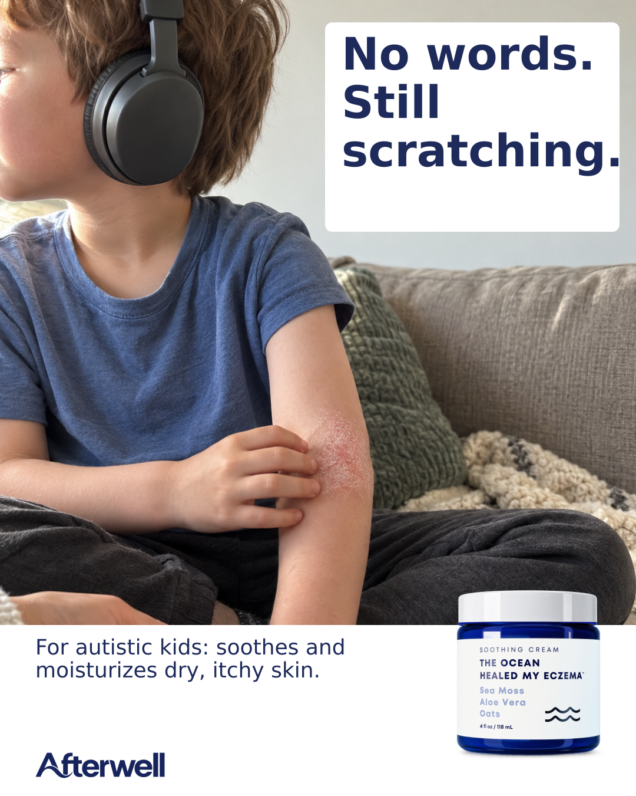</a> <strong>01 · No words. Still scratching.</strong> For autistic kids: soothes and moisturizes dry, itchy skin. <a href="statics/01-no-words-still-scratching.png">Download PNG 01</a></td>
<td width="33%" valign="top"><a href="statics/02-for-autistic-kids-cream-can-feel-like-slime.png">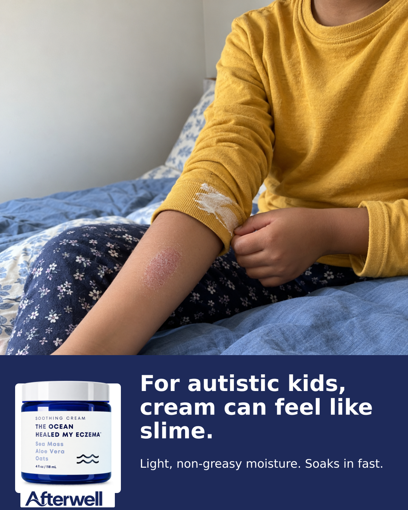</a> <strong>02 · For autistic kids, cream can feel like slime.</strong> Light, non-greasy moisture. Soaks in fast. <a href="statics/02-for-autistic-kids-cream-can-feel-like-slime.png">Download PNG 02</a></td>
<td width="33%" valign="top"><a href="statics/03-bath-pajamas-cream-then-everything-stops.png">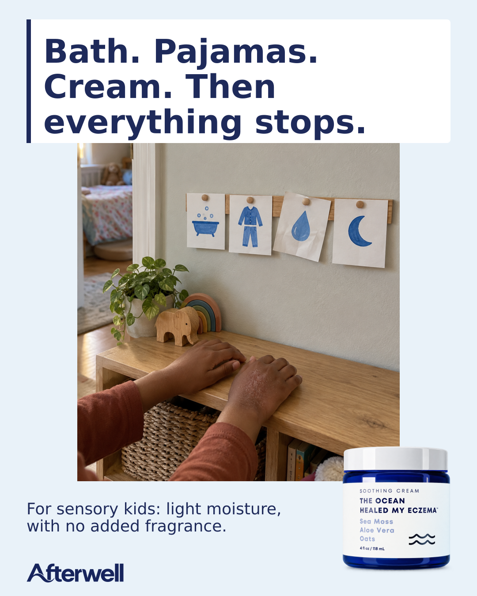</a> <strong>03 · Bath. Pajamas. Cream. Then everything stops.</strong> For sensory kids: light moisture, with no added fragrance. <a href="statics/03-bath-pajamas-cream-then-everything-stops.png">Download PNG 03</a></td>
</tr>
<tr>
<td width="33%" valign="top"><a href="statics/04-same-bedtime-cream-changes-the-plan.png">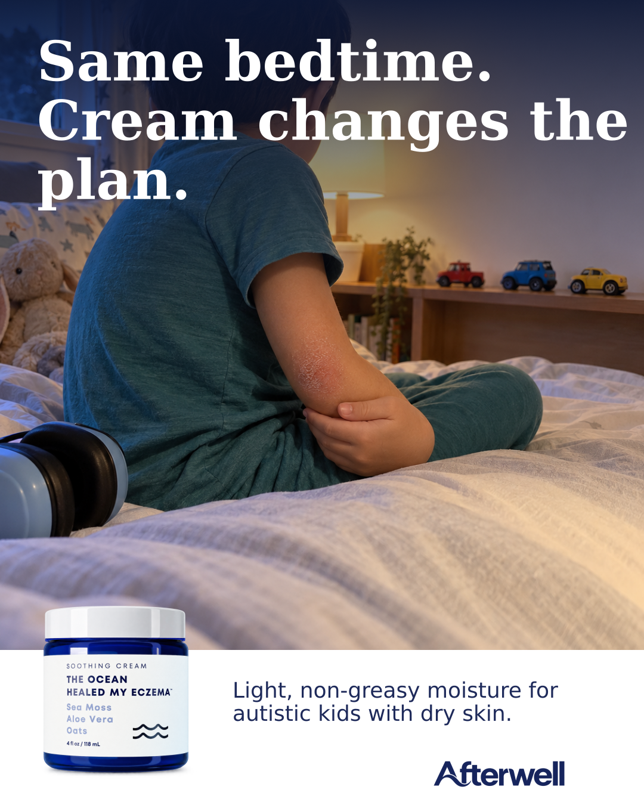</a> <strong>04 · Same bedtime. Cream changes the plan.</strong> Light, non-greasy moisture for autistic kids with dry skin. <a href="statics/04-same-bedtime-cream-changes-the-plan.png">Download PNG 04</a></td>
<td width="33%" valign="top"><a href="statics/05-favourite-shirt-on-cream-still-waits.png">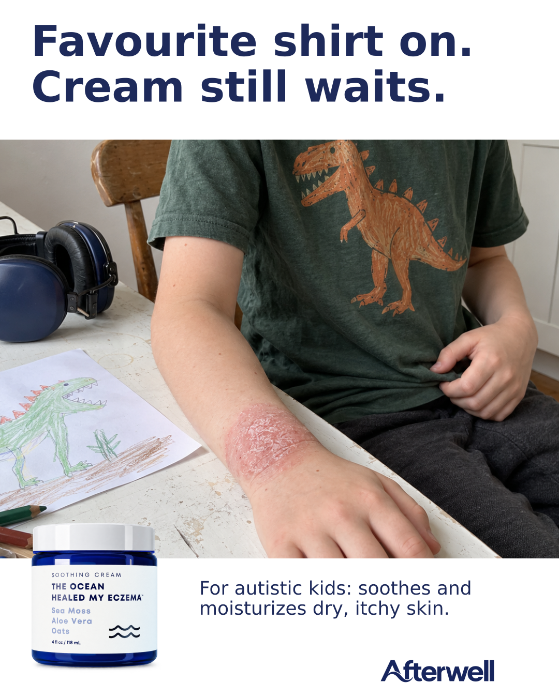</a> <strong>05 · Favourite shirt on. Cream still waits.</strong> For autistic kids: soothes and moisturizes dry, itchy skin. <a href="statics/05-favourite-shirt-on-cream-still-waits.png">Download PNG 05</a></td>
<td width="33%" valign="top"><a href="statics/06-tags-seams-now-the-cream-feels-wrong.png">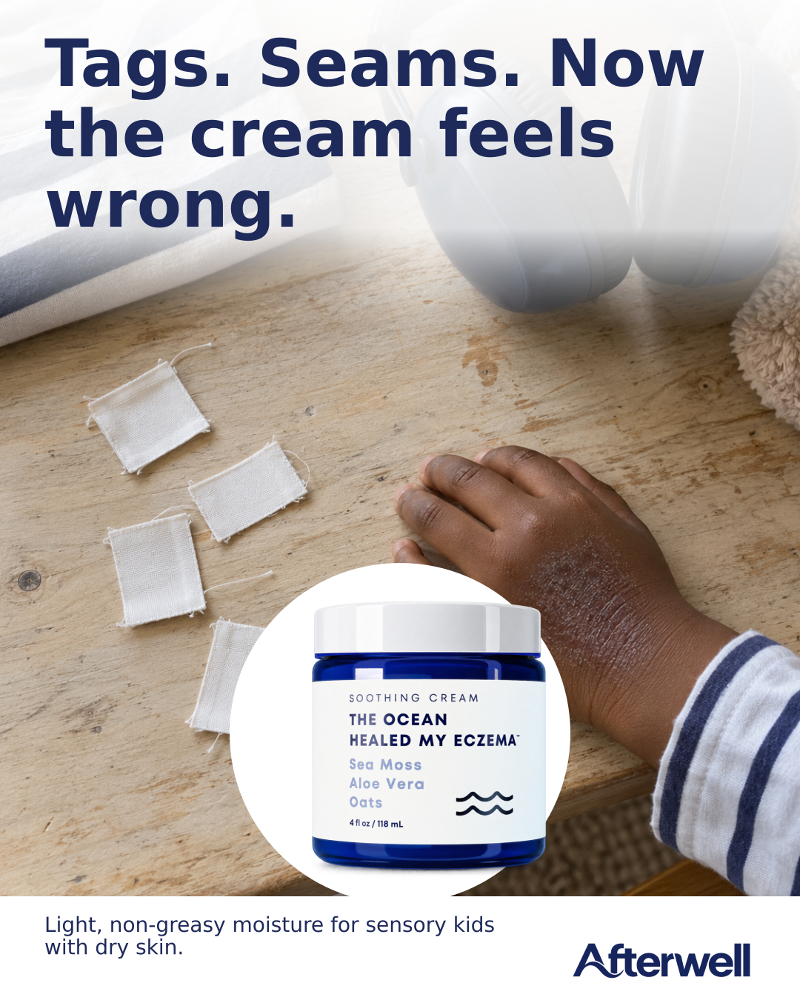</a> <strong>06 · Tags. Seams. Now the cream feels wrong.</strong> Light, non-greasy moisture for sensory kids with dry skin. <a href="statics/06-tags-seams-now-the-cream-feels-wrong.png">Download PNG 06</a></td>
</tr>
<tr>
<td width="33%" valign="top"><a href="statics/07-cream-time-waits-until-the-house-sleeps.png">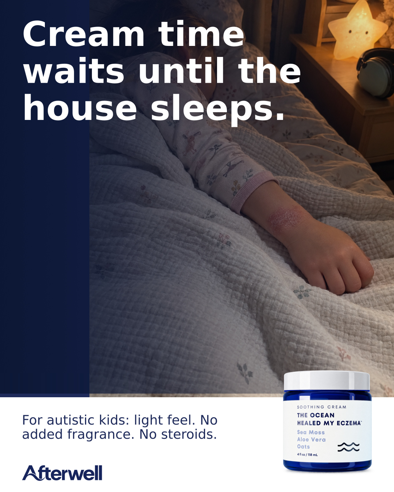</a> <strong>07 · Cream time waits until the house sleeps.</strong> For autistic kids: light feel. No added fragrance. No steroids. <a href="statics/07-cream-time-waits-until-the-house-sleeps.png">Download PNG 07</a></td>
<td width="33%" valign="top"><a href="statics/08-the-room-is-loud-the-itch-is-louder.png">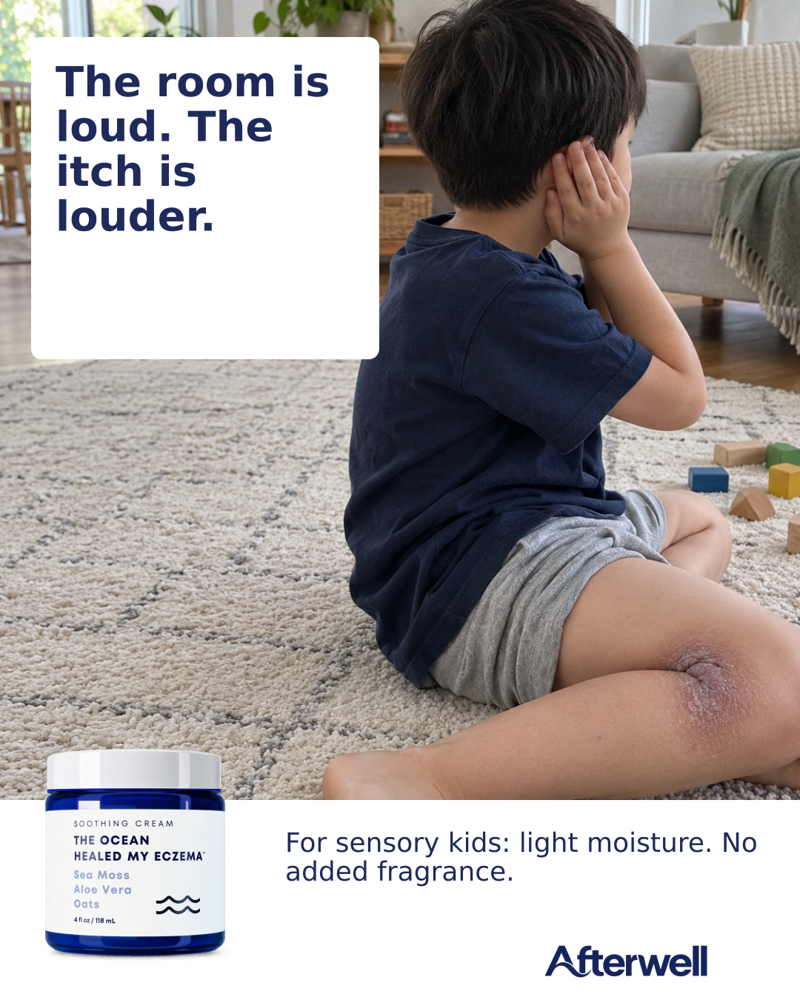</a> <strong>08 · The room is loud. The itch is louder.</strong> For sensory kids: light moisture. No added fragrance. <a href="statics/08-the-room-is-loud-the-itch-is-louder.png">Download PNG 08</a></td>
<td width="33%" valign="top"><a href="statics/09-an-autistic-kid-keeps-rubbing-it-could-be-itch.png">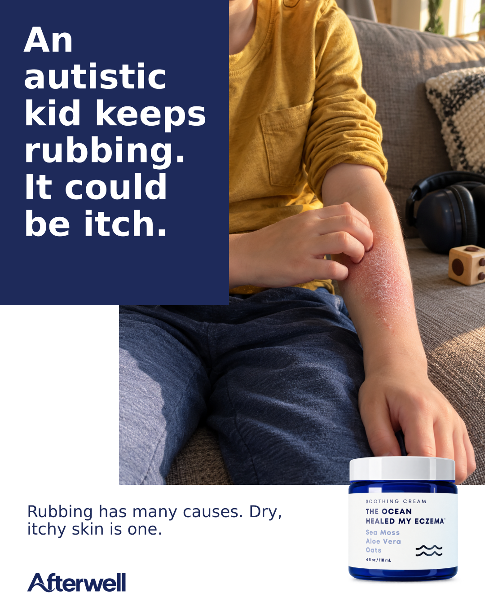</a> <strong>09 · An autistic kid keeps rubbing. It could be itch.</strong> Rubbing has many causes. Dry, itchy skin is one. <a href="statics/09-an-autistic-kid-keeps-rubbing-it-could-be-itch.png">Download PNG 09</a></td>
</tr>
<tr>
<td width="33%" valign="top"><a href="statics/10-drawing-stops-the-scratching-starts.png">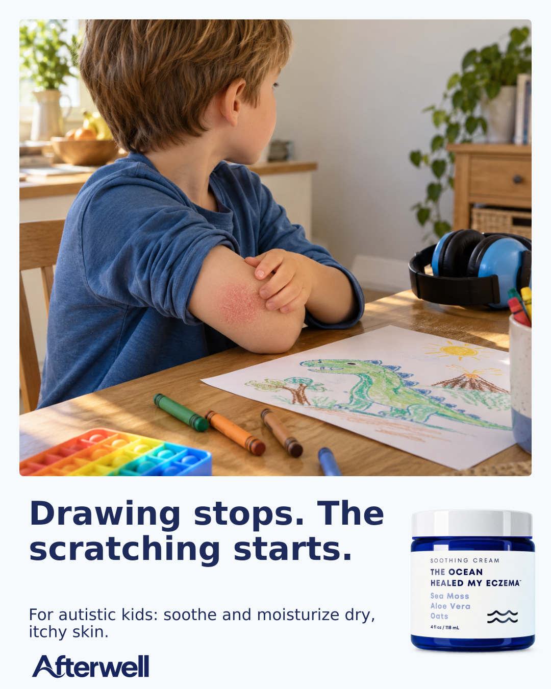</a> <strong>10 · Drawing stops. The scratching starts.</strong> For autistic kids: soothe and moisturize dry, itchy skin. <a href="statics/10-drawing-stops-the-scratching-starts.png">Download PNG 10</a></td>
<td width="33%" valign="top"><a href="statics/11-for-autistic-kids-the-feel-matters-too.png">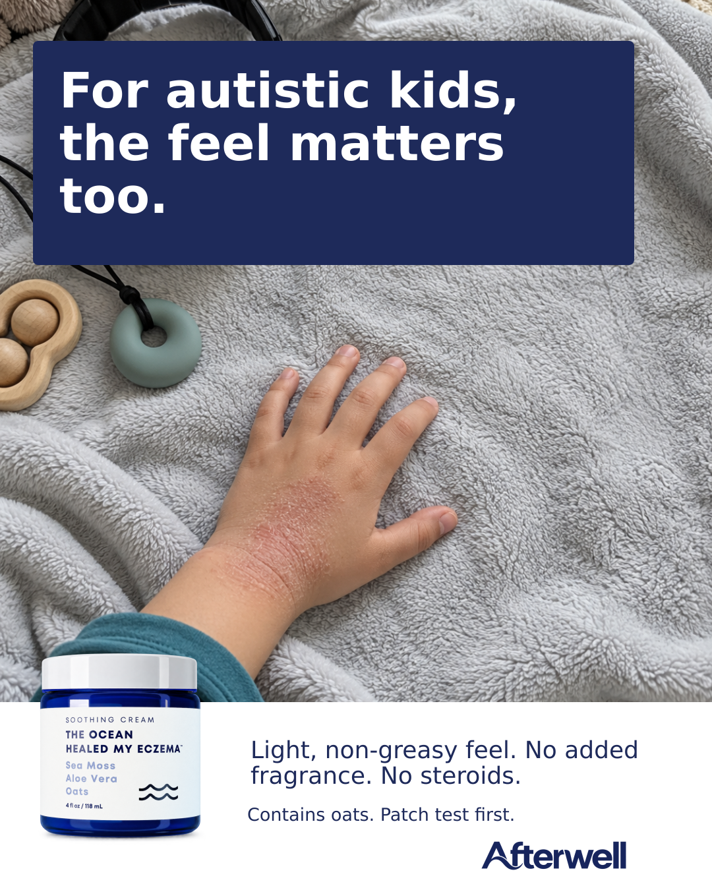</a> <strong>11 · For autistic kids, the feel matters too.</strong> Light, non-greasy feel. No added fragrance. No steroids. <a href="statics/11-for-autistic-kids-the-feel-matters-too.png">Download PNG 11</a></td>
<td width="33%" valign="top"><a href="statics/12-thick-cream-can-still-get-pushed-away.png">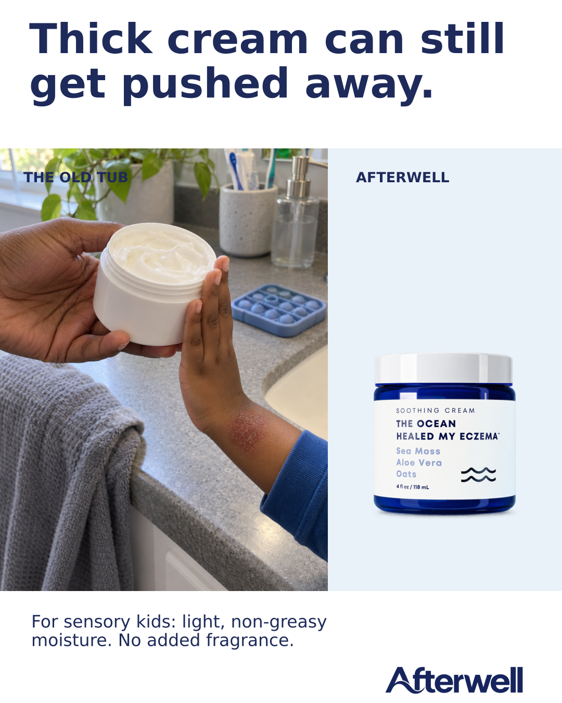</a> <strong>12 · Thick cream can still get pushed away.</strong> For sensory kids: light, non-greasy moisture. No added fragrance. <a href="statics/12-thick-cream-can-still-get-pushed-away.png">Download PNG 12</a></td>
</tr>
<tr>
<td width="33%" valign="top"><a href="statics/13-sensory-kids-notice-more-than-the-itch.png">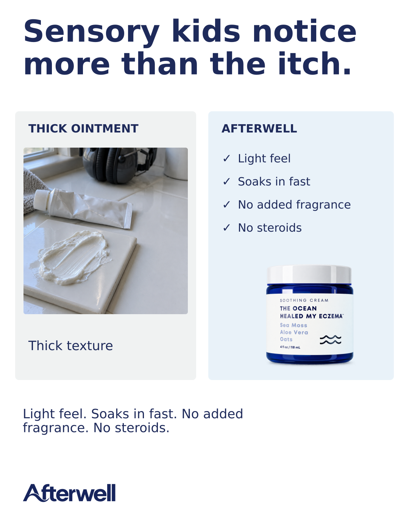</a> <strong>13 · Sensory kids notice more than the itch.</strong> Light feel. Soaks in fast. No added fragrance. No steroids. <a href="statics/13-sensory-kids-notice-more-than-the-itch.png">Download PNG 13</a></td>
<td width="33%" valign="top"><a href="statics/14-some-sensory-kids-pull-away-from-cream.png">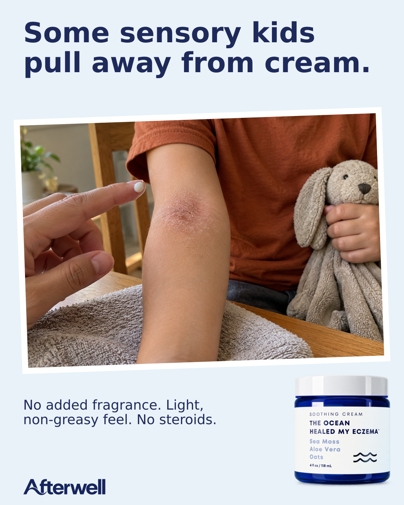</a> <strong>14 · Some sensory kids pull away from cream.</strong> No added fragrance. Light, non-greasy feel. No steroids. <a href="statics/14-some-sensory-kids-pull-away-from-cream.png">Download PNG 14</a></td>
<td width="33%" valign="top"><a href="statics/15-so-many-creams-the-feel-still-matters.png">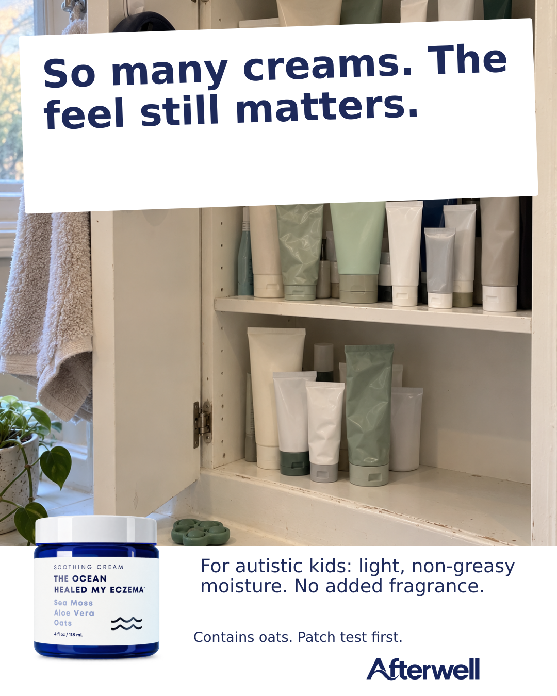</a> <strong>15 · So many creams. The feel still matters.</strong> For autistic kids: light, non-greasy moisture. No added fragrance. <a href="statics/15-so-many-creams-the-feel-still-matters.png">Download PNG 15</a></td>
</tr>
<tr>
<td width="33%" valign="top"><a href="statics/16-a-cream-card-a-little-more-choice.png">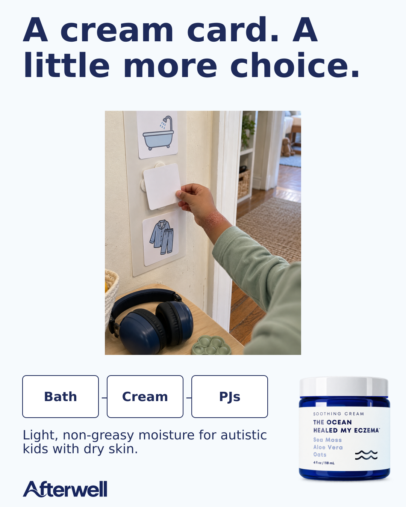</a> <strong>16 · A cream card. A little more choice.</strong> Light, non-greasy moisture for autistic kids with dry skin. <a href="statics/16-a-cream-card-a-little-more-choice.png">Download PNG 16</a></td>
<td width="33%" valign="top"><a href="statics/17-some-autistic-kids-want-to-apply-cream-themselves.png">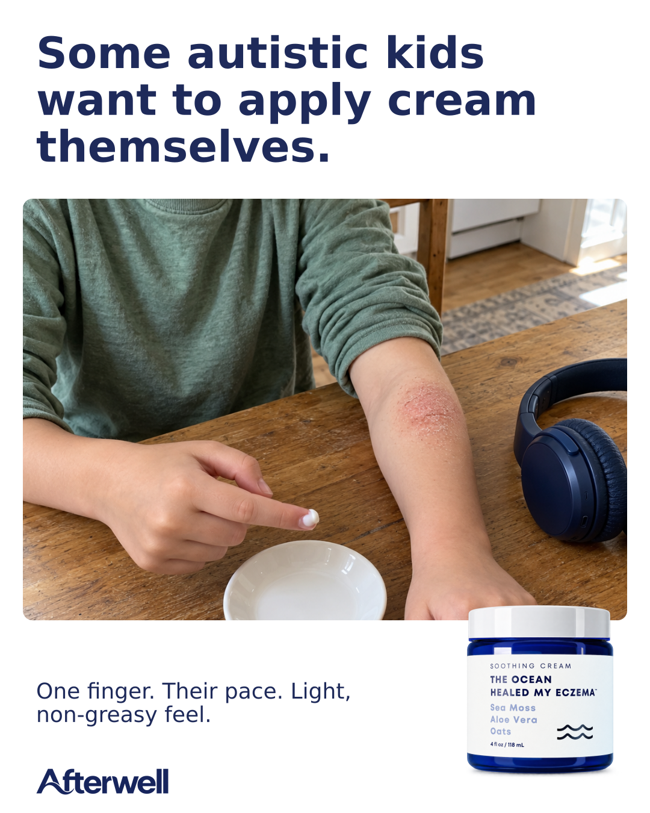</a> <strong>17 · Some autistic kids want to apply cream themselves.</strong> One finger. Their pace. Light, non-greasy feel. <a href="statics/17-some-autistic-kids-want-to-apply-cream-themselves.png">Download PNG 17</a></td>
<td width="33%" valign="top"><a href="statics/18-prescribed-care-daily-cream-different-jobs.png">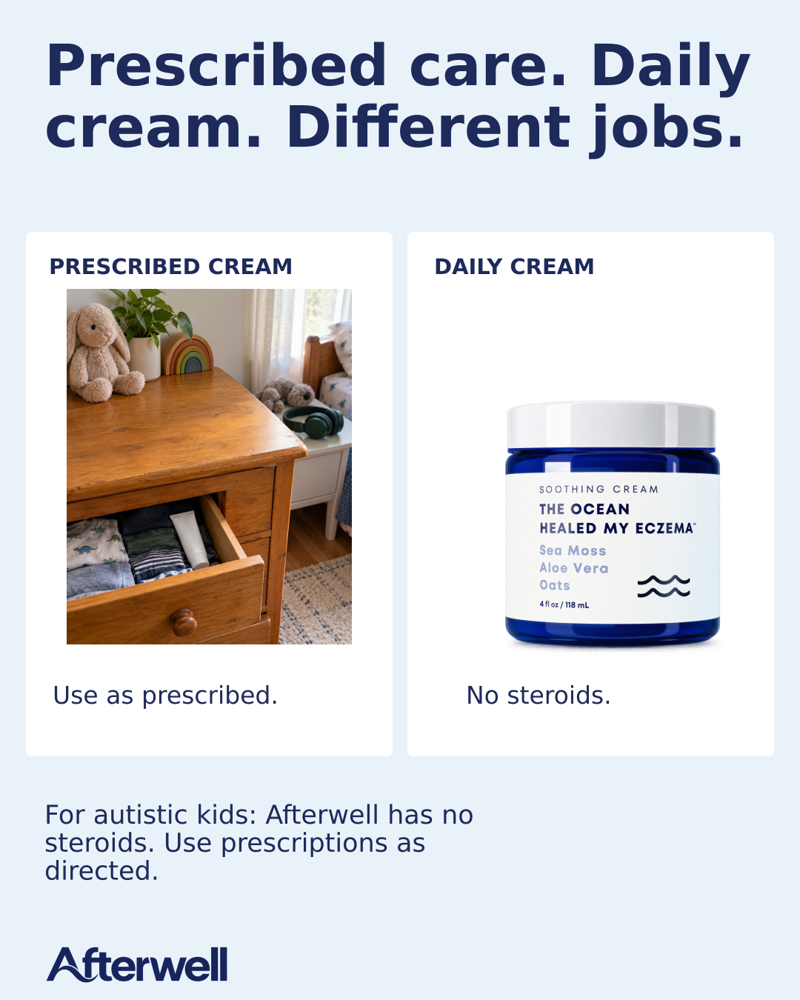</a> <strong>18 · Prescribed care. Daily cream. Different jobs.</strong> For autistic kids: Afterwell has no steroids. Use prescriptions as directed. <a href="statics/18-prescribed-care-daily-cream-different-jobs.png">Download PNG 18</a></td>
</tr>
<tr>
<td width="33%" valign="top"><a href="statics/19-sensory-kids-notice-the-first-touch.png">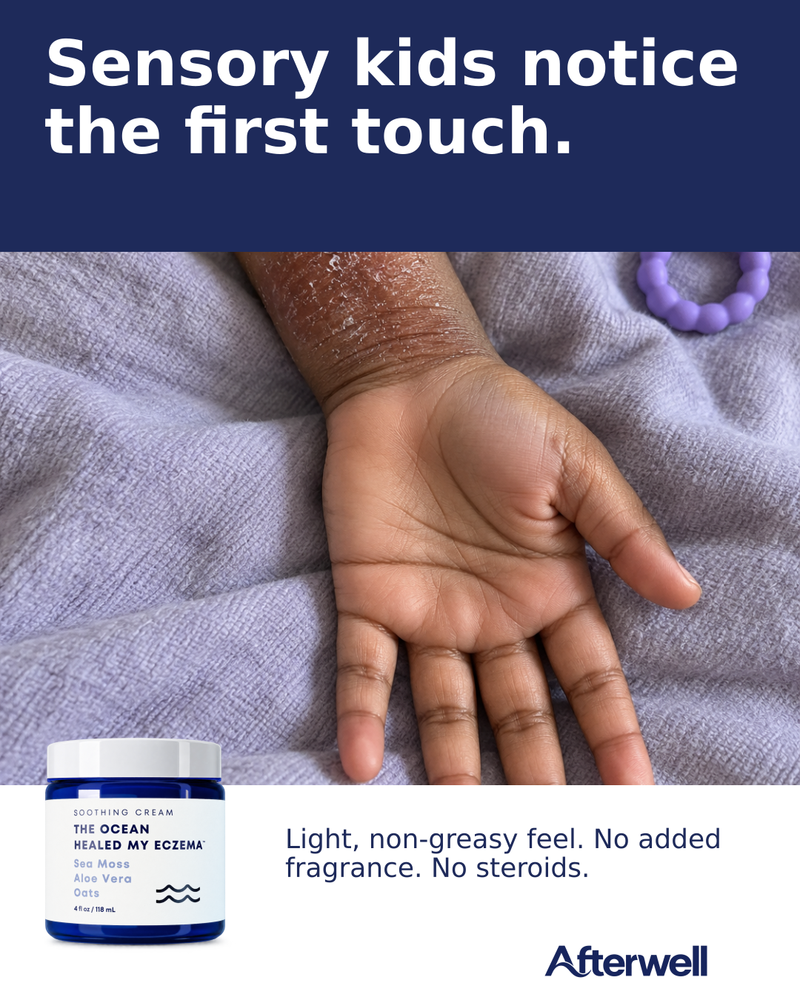</a> <strong>19 · Sensory kids notice the first touch.</strong> Light, non-greasy feel. No added fragrance. No steroids. <a href="statics/19-sensory-kids-notice-the-first-touch.png">Download PNG 19</a></td>
<td width="33%" valign="top"><a href="statics/20-bath-done-cream-is-the-next-hard-step.png">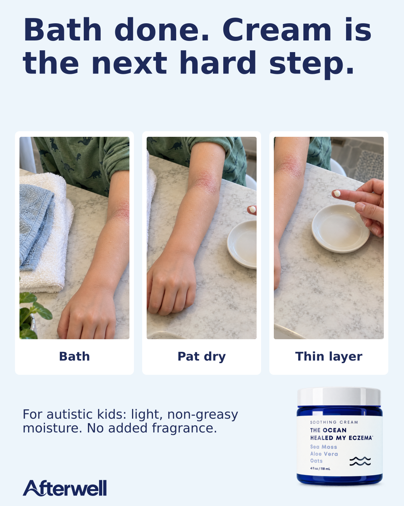</a> <strong>20 · Bath done. Cream is the next hard step.</strong> For autistic kids: light, non-greasy moisture. No added fragrance. <a href="statics/20-bath-done-cream-is-the-next-hard-step.png">Download PNG 20</a></td>
</tr>
</table>

## Rebuild the package

After all 20 renders and source records exist, run `python package_set.py`. Use `python package_set.py --check-only` to validate inputs without writing outputs. Packaging requires Python, Pillow, ReportLab and DejaVu Sans fonts. It never resizes or recompresses the final PNGs.
