# Afterwell · exact 30-ad set

30 final PNGs, numbered 01–30. Each is **1080 × 1350** pixels.

[Download the complete ZIP](afterwell-exact-30.zip) · [Individual PNG folder](statics/) · [Contact sheet PDF](contact-sheet.pdf) · [Overview JPG](contact-sheet.jpg)

[Browser gallery](index.html) · [Copy CSV](copy-index.csv) · [Copy JSON](copy-index.json) · [Source notes](sources.md) · [Editable SVGs](editable/)

Download and extract the ZIP, then open `index.html` in your browser to view all 30 ads and download individual full-size PNGs. The ZIP contains the final PNGs, gallery, copy indexes, source notes and contact PDF. Editable SVGs and supporting assets are available separately in this repository.

The original product label, including **THE OCEAN HEALED MY ECZEMA**, is retained on one fixed isolated product master. The supplied official Afterwell mark is blue and placed separately in the footer. New scenes are AI-generated illustrations; people shown are not customers, and images do not show clinical results. See [sources.md](sources.md) for the edited-asset workflow and full production notes.

## Preview all 30

Select any preview for its full-size PNG.

<table>
<tr>
<td width="33%" valign="top"><a href="statics/01-thicker-cream-drier-skin.png">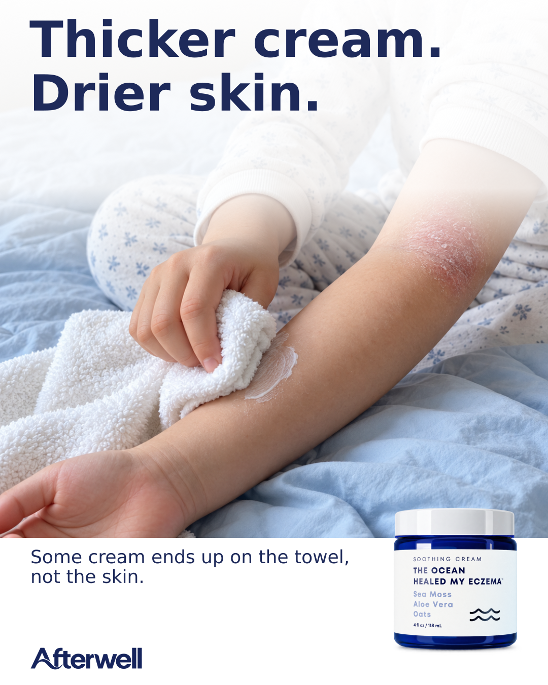</a> <strong>01 · Thicker cream. Drier skin.</strong> Some cream ends up on the towel, not the skin. <a href="statics/01-thicker-cream-drier-skin.png">Download PNG 01</a></td>
<td width="33%" valign="top"><a href="statics/02-waiting-until-they-re-asleep-again.png">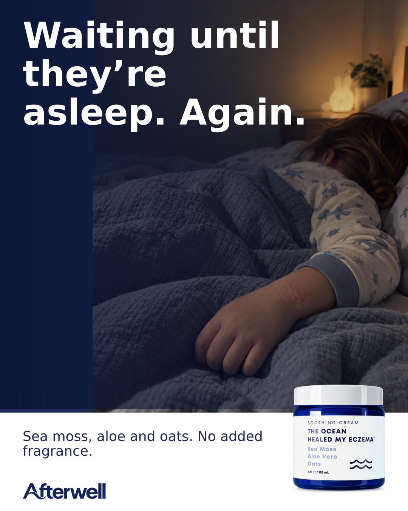</a> <strong>02 · Waiting until they’re asleep. Again.</strong> Sea moss, aloe and oats. No added fragrance. <a href="statics/02-waiting-until-they-re-asleep-again.png">Download PNG 02</a></td>
<td width="33%" valign="top"><a href="statics/03-the-cream-stayed-on-the-sleeve.png">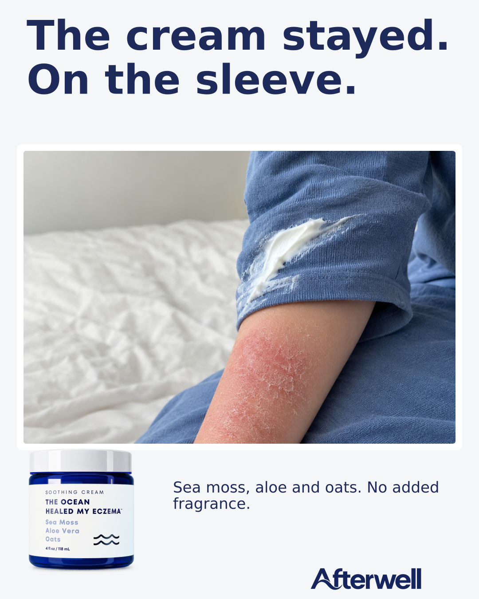</a> <strong>03 · The cream stayed. On the sleeve.</strong> Sea moss, aloe and oats. No added fragrance. <a href="statics/03-the-cream-stayed-on-the-sleeve.png">Download PNG 03</a></td>
</tr>
<tr>
<td width="33%" valign="top"><a href="statics/04-more-tubes-the-same-dry-patch.png">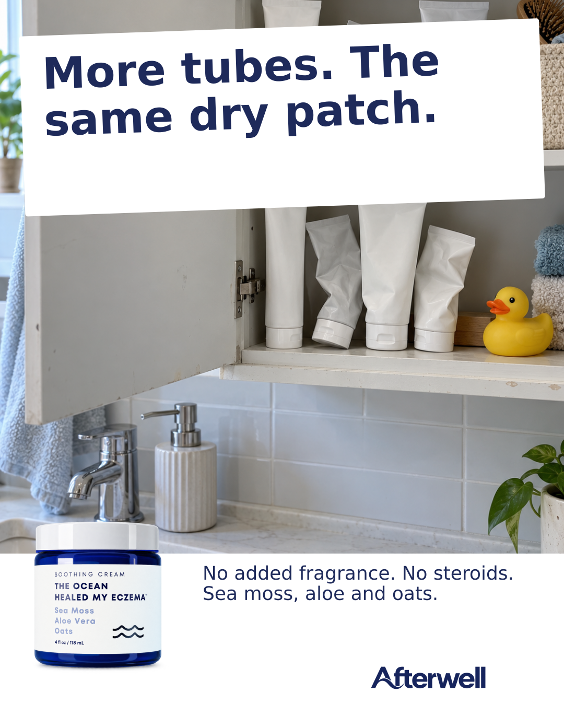</a> <strong>04 · More tubes. The same dry patch.</strong> No added fragrance. No steroids. Sea moss, aloe and oats. <a href="statics/04-more-tubes-the-same-dry-patch.png">Download PNG 04</a></td>
<td width="33%" valign="top"><a href="statics/05-a-small-touch-a-big-feeling.png">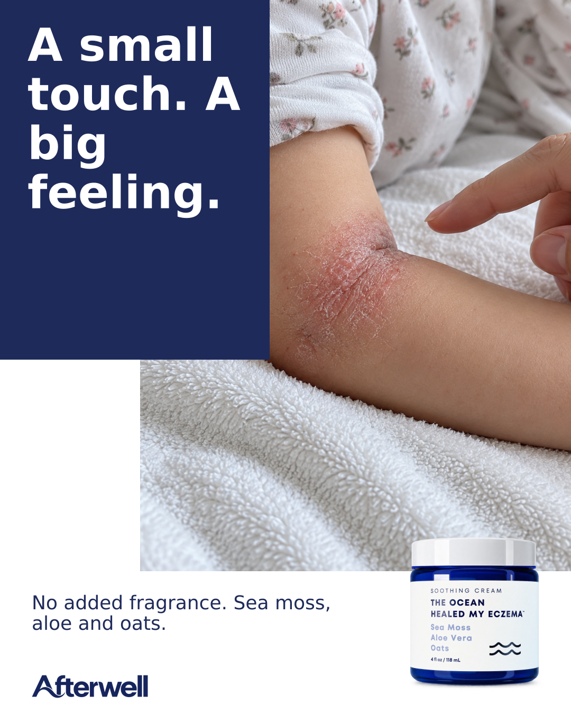</a> <strong>05 · A small touch. A big feeling.</strong> No added fragrance. Sea moss, aloe and oats. <a href="statics/05-a-small-touch-a-big-feeling.png">Download PNG 05</a></td>
<td width="33%" valign="top"><a href="statics/06-one-quick-scratch-then-more-itch.png">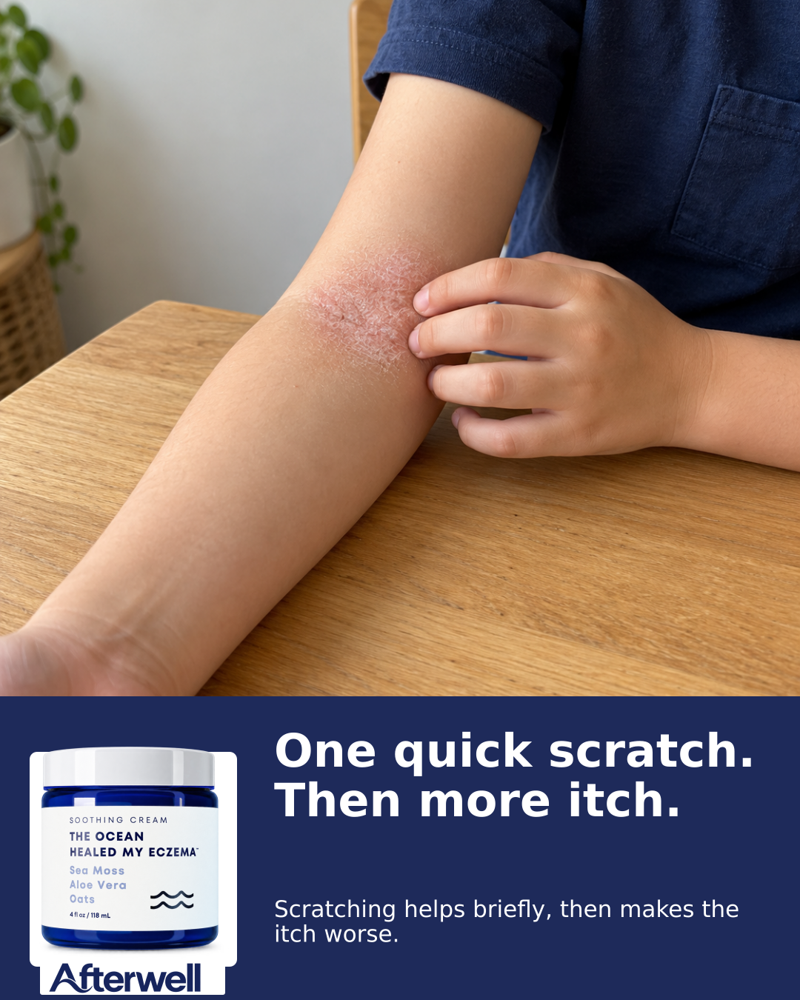</a> <strong>06 · One quick scratch. Then more itch.</strong> Scratching helps briefly, then makes the itch worse. <a href="statics/06-one-quick-scratch-then-more-itch.png">Download PNG 06</a></td>
</tr>
<tr>
<td width="33%" valign="top"><a href="statics/07-heater-on-dry-skin-follows.png">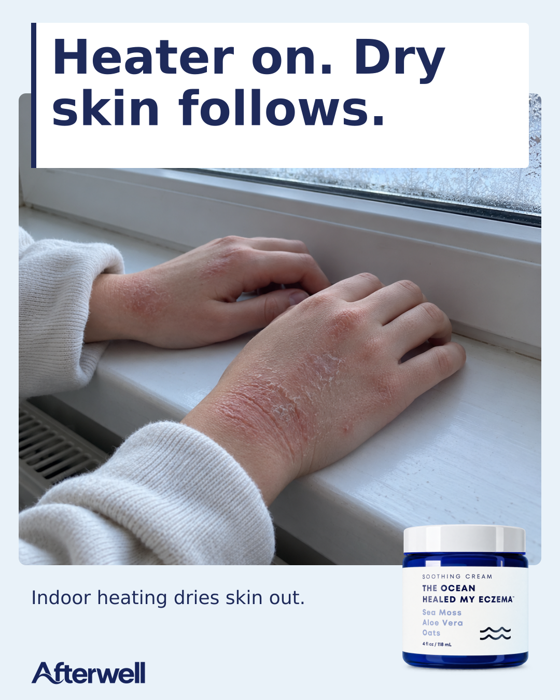</a> <strong>07 · Heater on. Dry skin follows.</strong> Indoor heating dries skin out. <a href="statics/07-heater-on-dry-skin-follows.png">Download PNG 07</a></td>
<td width="33%" valign="top"><a href="statics/08-socks-on-little-hands-again.png">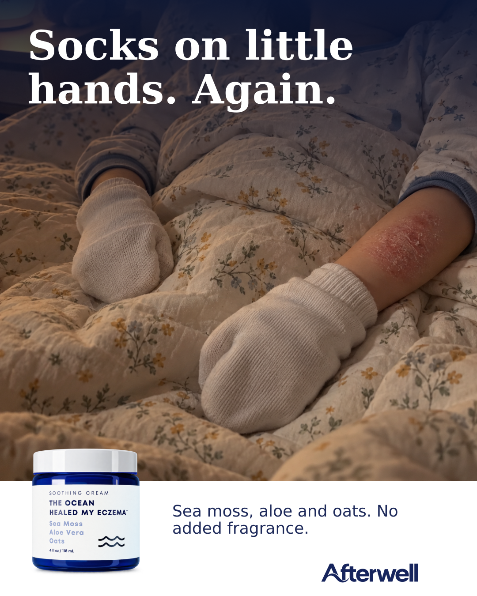</a> <strong>08 · Socks on little hands. Again.</strong> Sea moss, aloe and oats. No added fragrance. <a href="statics/08-socks-on-little-hands-again.png">Download PNG 08</a></td>
<td width="33%" valign="top"><a href="statics/09-bath-done-keep-the-skin-damp.png">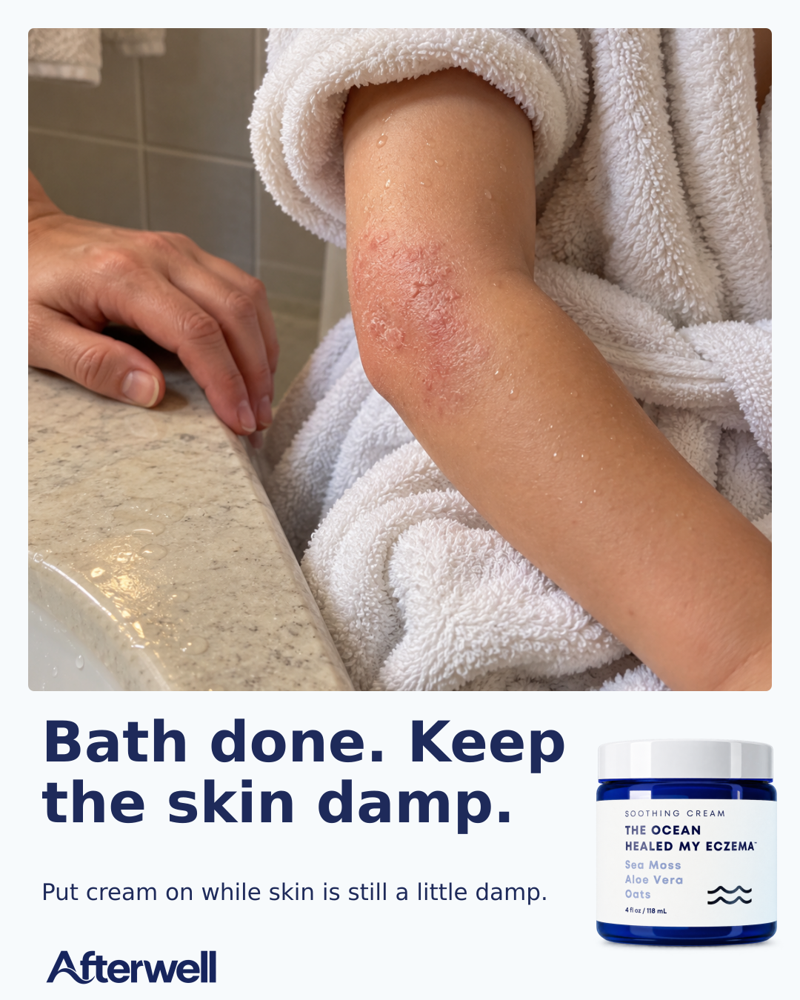</a> <strong>09 · Bath done. Keep the skin damp.</strong> Put cream on while skin is still a little damp. <a href="statics/09-bath-done-keep-the-skin-damp.png">Download PNG 09</a></td>
</tr>
<tr>
<td width="33%" valign="top"><a href="statics/10-cream-time-blanket-over-the-head.png">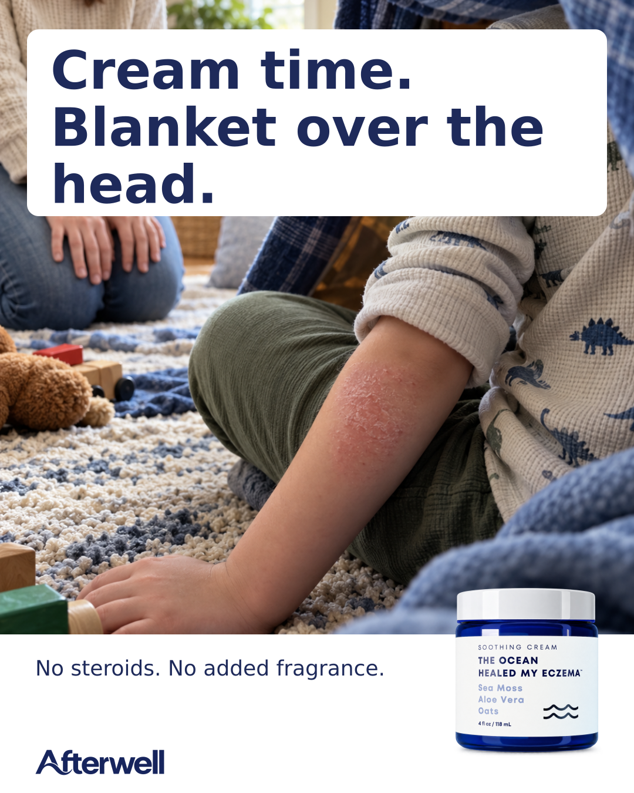</a> <strong>10 · Cream time. Blanket over the head.</strong> No steroids. No added fragrance. <a href="statics/10-cream-time-blanket-over-the-head.png">Download PNG 10</a></td>
<td width="33%" valign="top"><a href="statics/11-the-tube-says-gentle-they-pull-away.png">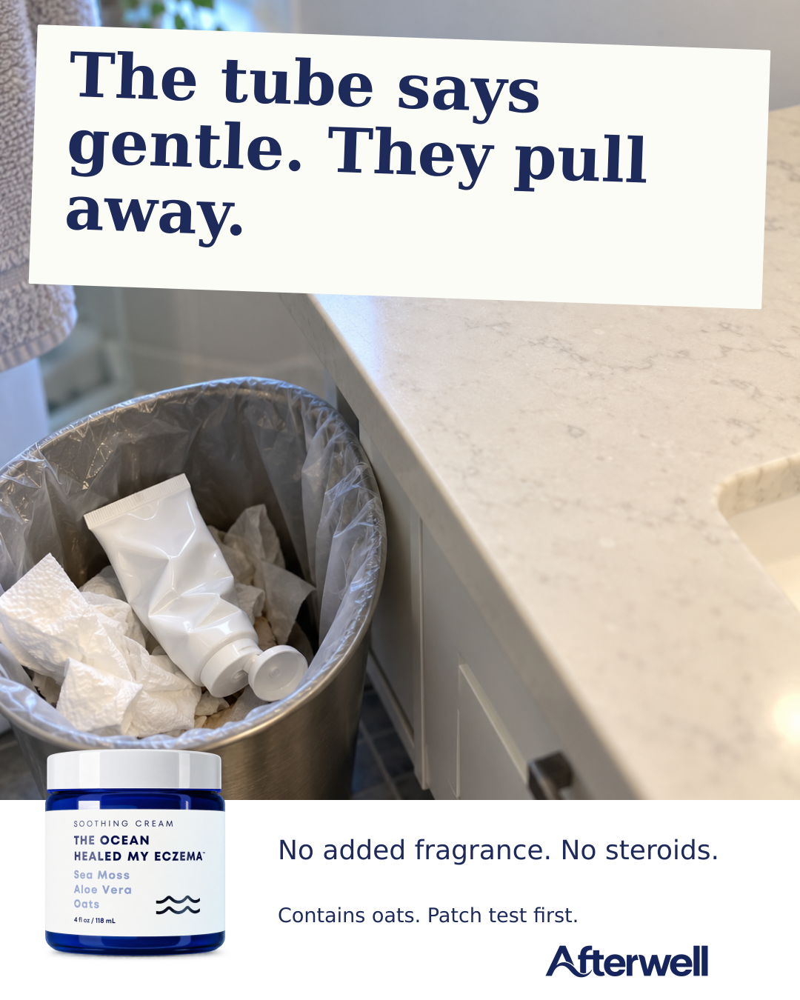</a> <strong>11 · The tube says gentle. They pull away.</strong> No added fragrance. No steroids. <a href="statics/11-the-tube-says-gentle-they-pull-away.png">Download PNG 11</a></td>
<td width="33%" valign="top"><a href="statics/12-small-hands-a-say-in-cream-time.png">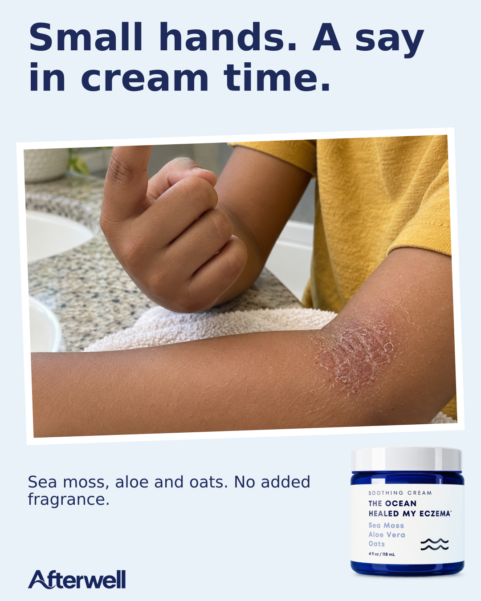</a> <strong>12 · Small hands. A say in cream time.</strong> Sea moss, aloe and oats. No added fragrance. <a href="statics/12-small-hands-a-say-in-cream-time.png">Download PNG 12</a></td>
</tr>
<tr>
<td width="33%" valign="top"><a href="statics/13-thick-ointment-what-s-in-the-other-jar.png">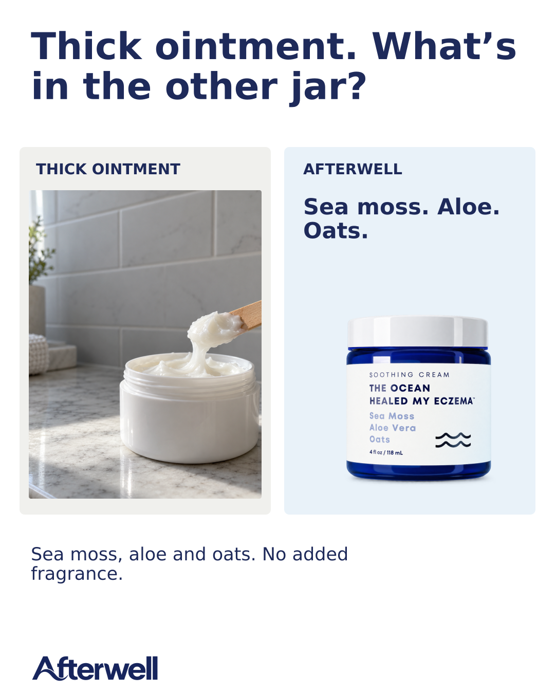</a> <strong>13 · Thick ointment. What’s in the other jar?</strong> Sea moss, aloe and oats. No added fragrance. <a href="statics/13-thick-ointment-what-s-in-the-other-jar.png">Download PNG 13</a></td>
<td width="33%" valign="top"><a href="statics/14-unscented-can-still-mean-added-scent.png">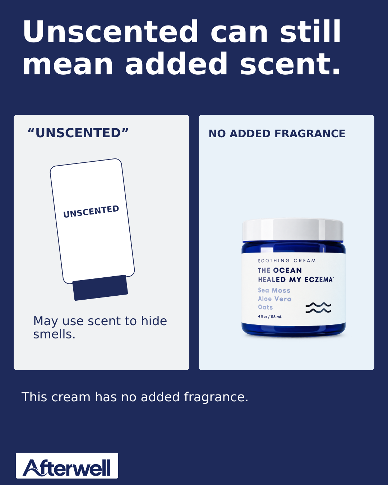</a> <strong>14 · Unscented can still mean added scent.</strong> This cream has no added fragrance. <a href="statics/14-unscented-can-still-mean-added-scent.png">Download PNG 14</a></td>
<td width="33%" valign="top"><a href="statics/15-two-creams-two-different-jobs.png">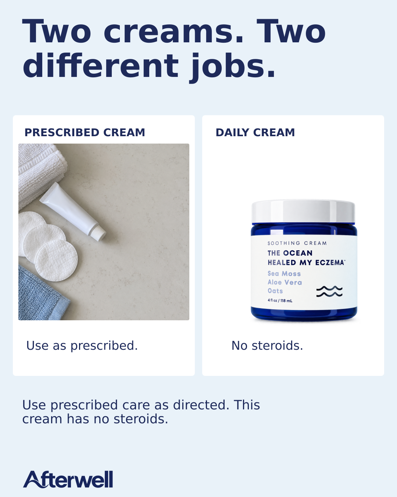</a> <strong>15 · Two creams. Two different jobs.</strong> Use prescribed care as directed. This cream has no steroids. <a href="statics/15-two-creams-two-different-jobs.png">Download PNG 15</a></td>
</tr>
<tr>
<td width="33%" valign="top"><a href="statics/16-full-cabinet-still-nothing-stays-on.png">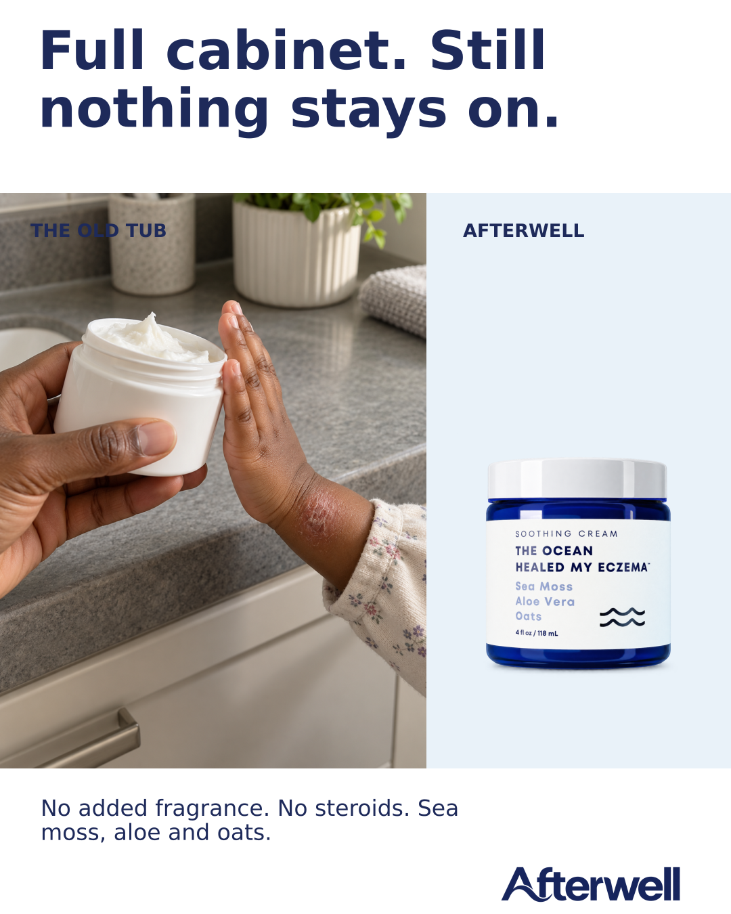</a> <strong>16 · Full cabinet. Still nothing stays on.</strong> No added fragrance. No steroids. Sea moss, aloe and oats. <a href="statics/16-full-cabinet-still-nothing-stays-on.png">Download PNG 16</a></td>
<td width="33%" valign="top"><a href="statics/17-three-familiar-names-read-the-full-list.png">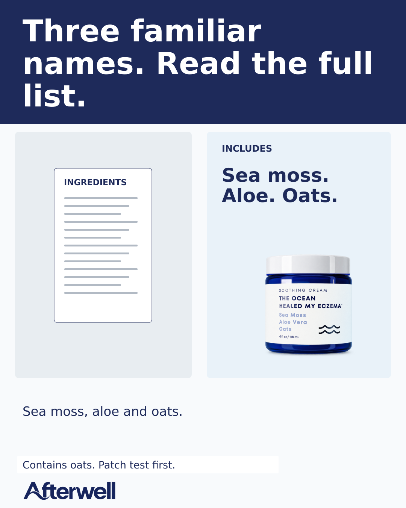</a> <strong>17 · Three familiar names. Read the full list.</strong> Sea moss, aloe and oats. <a href="statics/17-three-familiar-names-read-the-full-list.png">Download PNG 17</a></td>
<td width="33%" valign="top"><a href="statics/18-three-familiar-names-no-steroids.png">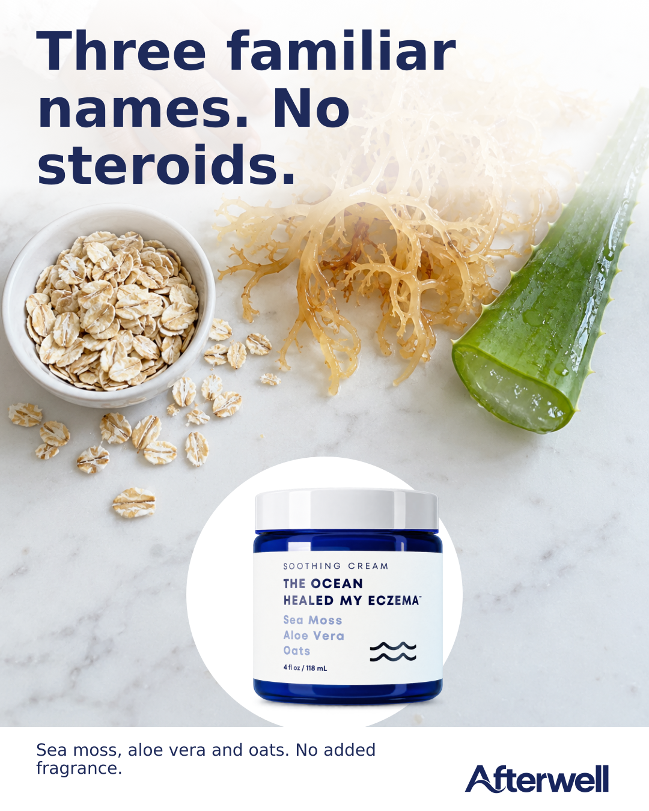</a> <strong>18 · Three familiar names. No steroids.</strong> Sea moss, aloe vera and oats. No added fragrance. <a href="statics/18-three-familiar-names-no-steroids.png">Download PNG 18</a></td>
</tr>
<tr>
<td width="33%" valign="top"><a href="statics/19-seaweed-in-the-cream-jar.png">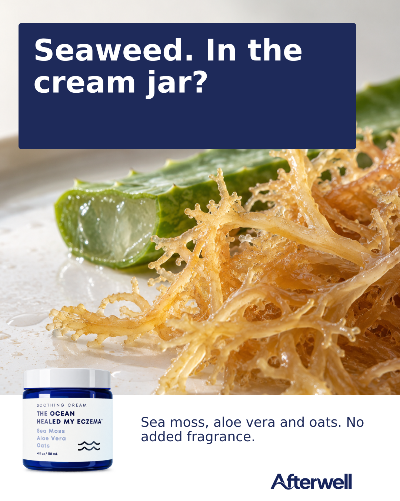</a> <strong>19 · Seaweed. In the cream jar?</strong> Sea moss, aloe vera and oats. No added fragrance. <a href="statics/19-seaweed-in-the-cream-jar.png">Download PNG 19</a></td>
<td width="33%" valign="top"><a href="statics/20-read-the-label-even-this-one.png">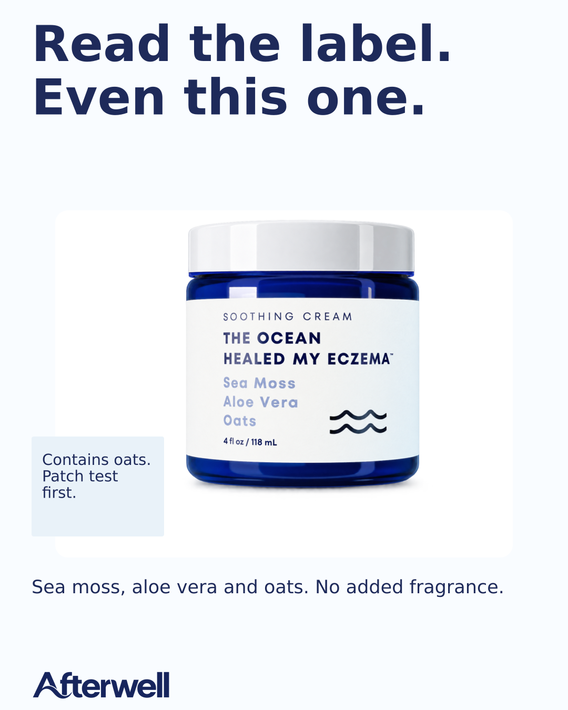</a> <strong>20 · Read the label. Even this one.</strong> Sea moss, aloe vera and oats. No added fragrance. <a href="statics/20-read-the-label-even-this-one.png">Download PNG 20</a></td>
<td width="33%" valign="top"><a href="statics/21-the-back-label-gets-a-second-look.png">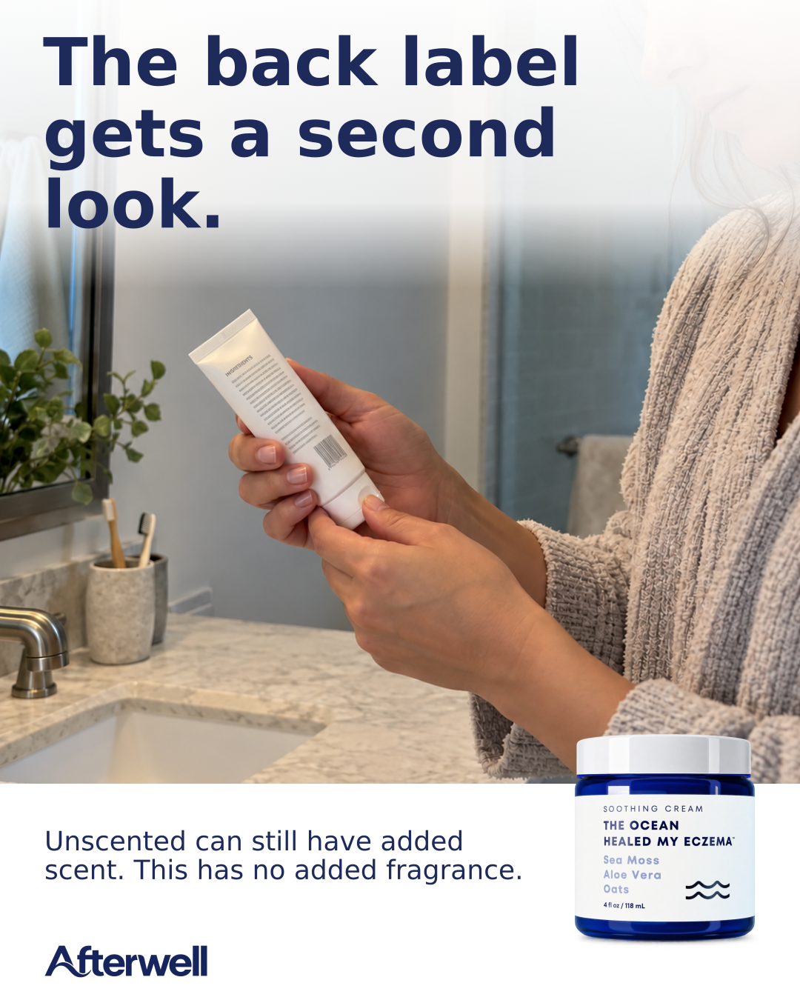</a> <strong>21 · The back label gets a second look.</strong> Unscented can still have added scent. This has no added fragrance. <a href="statics/21-the-back-label-gets-a-second-look.png">Download PNG 21</a></td>
</tr>
<tr>
<td width="33%" valign="top"><a href="statics/22-everyone-s-asleep-the-cream-is-still-out.png">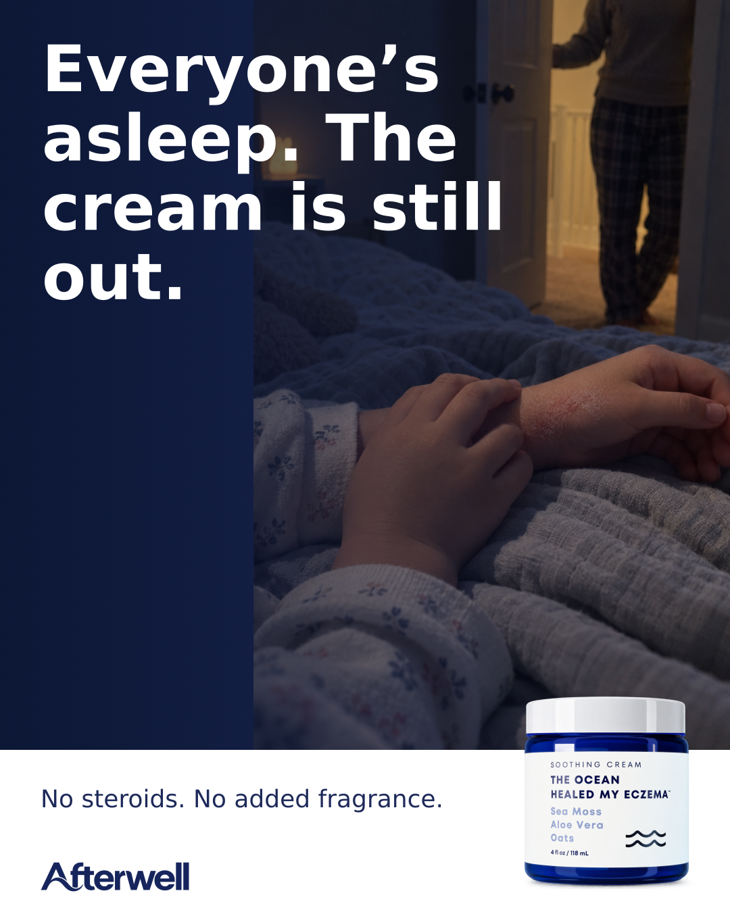</a> <strong>22 · Everyone’s asleep. The cream is still out.</strong> No steroids. No added fragrance. <a href="statics/22-everyone-s-asleep-the-cream-is-still-out.png">Download PNG 22</a></td>
<td width="33%" valign="top"><a href="statics/23-long-sleeves-still-that-dry-patch.png">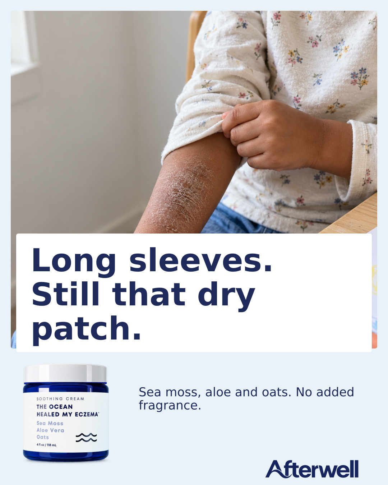</a> <strong>23 · Long sleeves. Still that dry patch.</strong> Sea moss, aloe and oats. No added fragrance. <a href="statics/23-long-sleeves-still-that-dry-patch.png">Download PNG 23</a></td>
<td width="33%" valign="top"><a href="statics/24-same-cream-two-different-answers.png">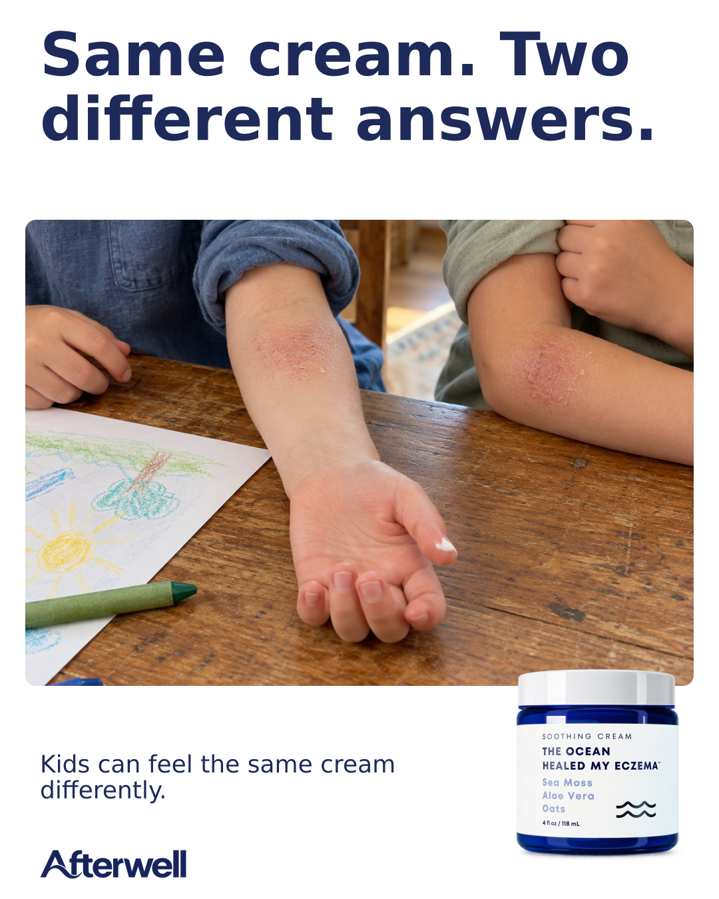</a> <strong>24 · Same cream. Two different answers.</strong> Kids can feel the same cream differently. <a href="statics/24-same-cream-two-different-answers.png">Download PNG 24</a></td>
</tr>
<tr>
<td width="33%" valign="top"><a href="statics/25-prescribed-care-plus-the-daily-cream.png">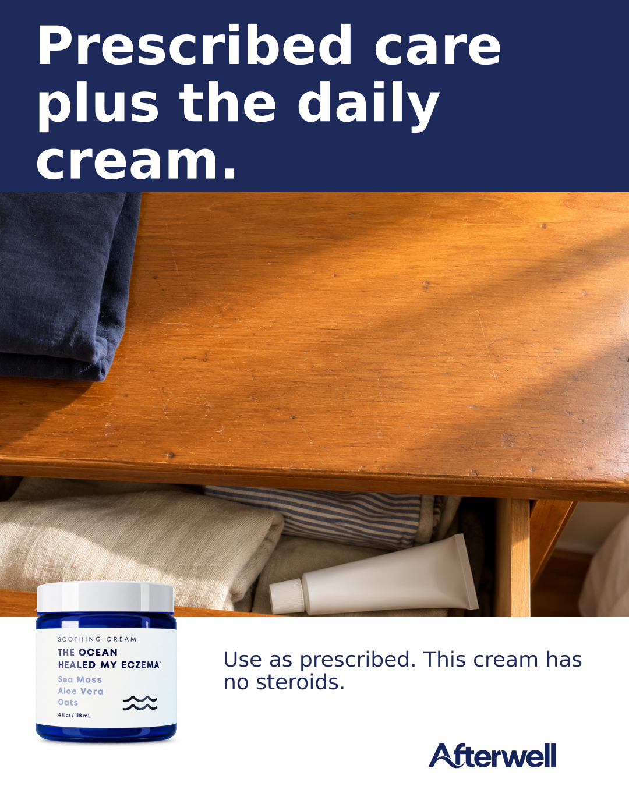</a> <strong>25 · Prescribed care plus the daily cream.</strong> Use as prescribed. This cream has no steroids. <a href="statics/25-prescribed-care-plus-the-daily-cream.png">Download PNG 25</a></td>
<td width="33%" valign="top"><a href="statics/26-itchy-night-same-skin-tired-morning.png">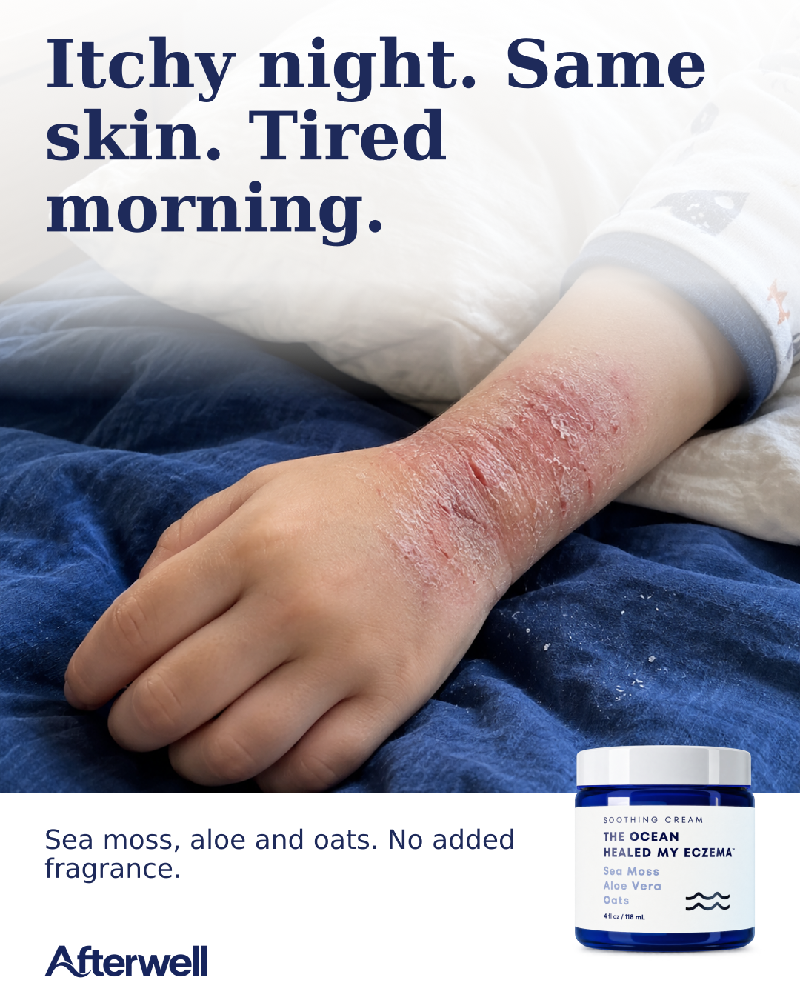</a> <strong>26 · Itchy night. Same skin. Tired morning.</strong> Sea moss, aloe and oats. No added fragrance. <a href="statics/26-itchy-night-same-skin-tired-morning.png">Download PNG 26</a></td>
<td width="33%" valign="top"><a href="statics/27-a-tiny-dab-a-big-deal.png">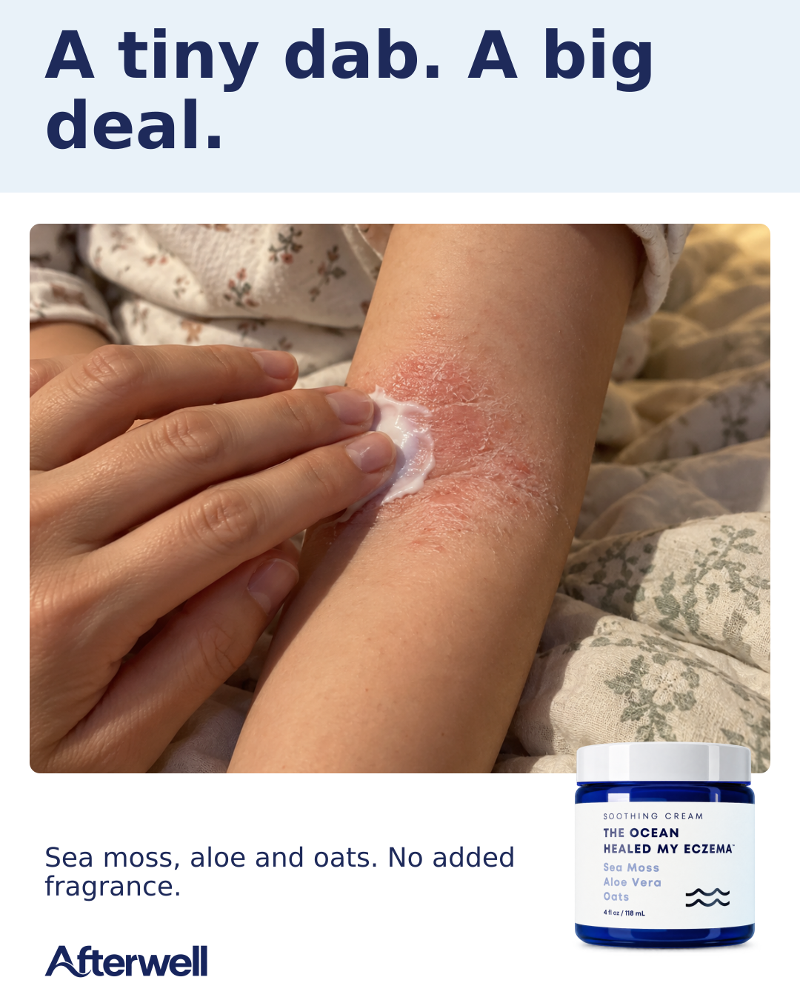</a> <strong>27 · A tiny dab. A big deal.</strong> Sea moss, aloe and oats. No added fragrance. <a href="statics/27-a-tiny-dab-a-big-deal.png">Download PNG 27</a></td>
</tr>
<tr>
<td width="33%" valign="top"><a href="statics/28-one-bad-reaction-the-next-jar-waits.png">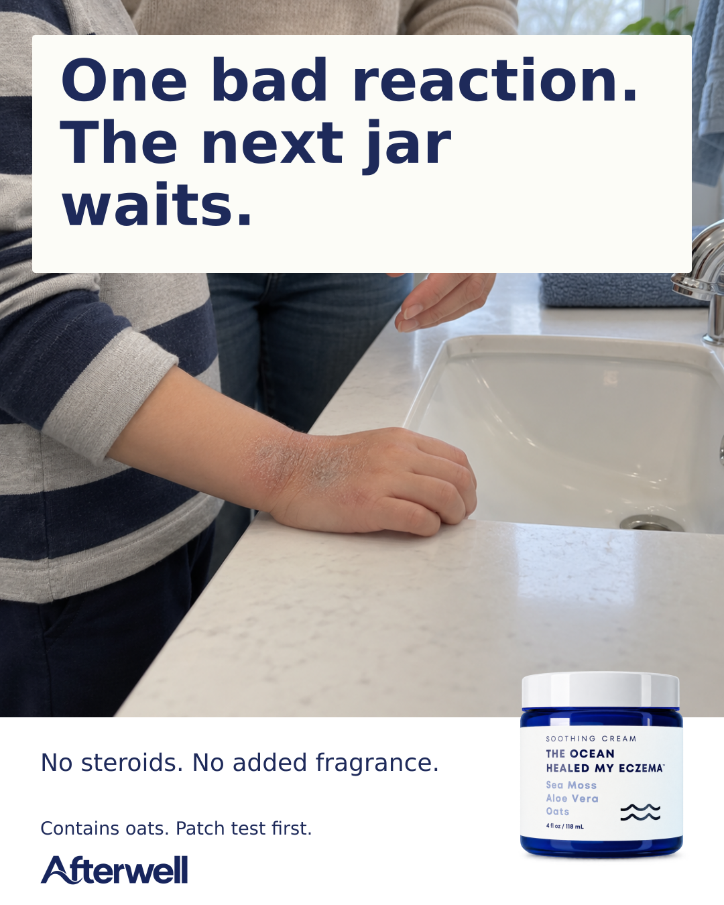</a> <strong>28 · One bad reaction. The next jar waits.</strong> No steroids. No added fragrance. <a href="statics/28-one-bad-reaction-the-next-jar-waits.png">Download PNG 28</a></td>
<td width="33%" valign="top"><a href="statics/29-check-for-fragrance-even-in-unscented-cream.png">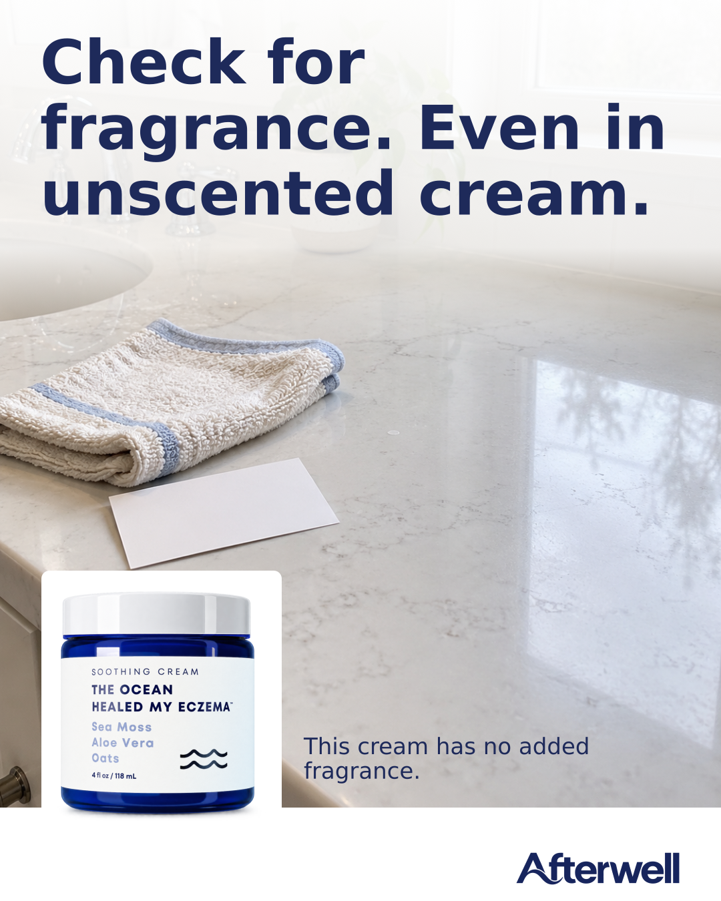</a> <strong>29 · Check for fragrance. Even in unscented cream.</strong> This cream has no added fragrance. <a href="statics/29-check-for-fragrance-even-in-unscented-cream.png">Download PNG 29</a></td>
<td width="33%" valign="top"><a href="statics/30-the-skin-shows-what-words-can-t.png">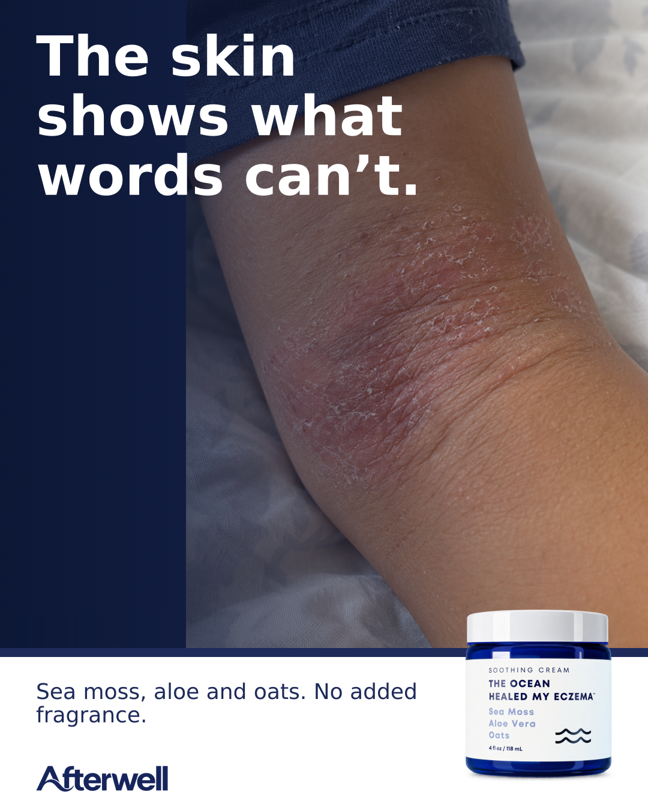</a> <strong>30 · The skin shows what words can’t.</strong> Sea moss, aloe and oats. No added fragrance. <a href="statics/30-the-skin-shows-what-words-can-t.png">Download PNG 30</a></td>
</tr>
</table>

## Rebuild the package

After all 30 renders and source records exist, run `python package_set.py`. Use `python package_set.py --check-only` to validate inputs without writing outputs. Packaging requires Python, Pillow, ReportLab and DejaVu Sans fonts. It never resizes or recompresses the final PNGs.
